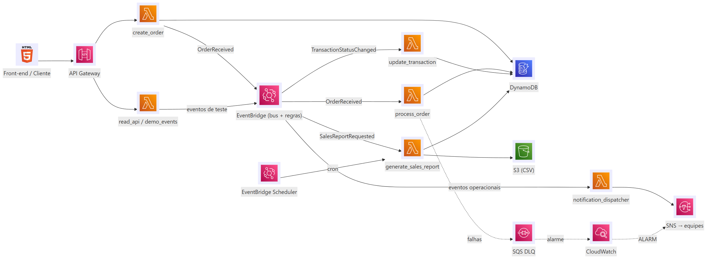
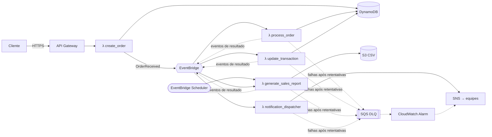

# TechCommerce Serverless — Automação de Processos com AWS Lambda e Amazon EventBridge

Projeto acadêmico da disciplina **Cloud Computing for Software Development (UniFECAF)**.

A TechCommerce, um e-commerce nacional em crescimento, depende de servidores dedicados e de
intervenções manuais para validar pedidos, atualizar transações, gerar relatórios e avisar as equipes.
Este projeto substitui esses processos por uma **arquitetura serverless orientada a eventos** em que
funções **AWS Lambda** são executadas automaticamente por **eventos da aplicação** e por
**agendamentos**, orquestrados pelo **Amazon EventBridge**.

> **Sobre os resultados apresentados:** todas as evidências deste repositório foram obtidas no
> **ambiente local simulado** (moto + simulador de EventBridge/Scheduler). A infraestrutura está pronta
> para a AWS (`sam validate --lint` e `sam build` executados com sucesso), mas **nenhum deploy real foi
> realizado** até o momento — ver [O que depende da AWS](#o-que-depende-de-configuração-ou-implantação-na-aws).

---

## Sumário

1. [Objetivo](#objetivo)
2. [Tecnologias](#tecnologias)
3. [Arquitetura](#arquitetura)
4. [Estrutura das pastas](#estrutura-das-pastas)
5. [Pré-requisitos](#pré-requisitos)
6. [Instalação](#instalação)
7. [Configuração](#configuração)
8. [Execução local](#execução-local-sem-conta-aws)
9. [Testes](#testes)
10. [Deploy na AWS](#deploy-na-aws)
11. [Exemplos de requisições](#exemplos-de-requisições)
12. [Como demonstrar cada automação](#como-demonstrar-cada-automação)
13. [Como consultar logs](#como-consultar-logs)
14. [Limitações conhecidas](#limitações-conhecidas)
15. [Entregáveis acadêmicos](#entregáveis-acadêmicos)

---

## Objetivo

Demonstrar que eventos podem disparar execuções automáticas em tempo real, sem servidores dedicados:

| Fluxo | Gatilho | Automação |
|---|---|---|
| 1. Pedidos | `POST /orders` → evento `OrderReceived` | valida, grava, aprova/rejeita e notifica a logística |
| 2. Transações | evento `TransactionStatusChanged` | atualiza pagamento (CAPTURED, DECLINED, REFUNDED…) com validação de transições |
| 3. Relatórios | **EventBridge Scheduler** (cron) ou evento `SalesReportRequested` | consolida vendas, gera CSV e salva no S3 |
| 4. Notificações | eventos `OrderApproved`, `OrderRejected`, `TransactionUpdated`, `ProcessingFailed`, `SalesReportGenerated` | publica no SNS com atributo de equipe |

## Tecnologias

- **Python 3.12** (funções Lambda; somente biblioteca padrão + `boto3` do runtime)
- **AWS SAM / CloudFormation** (infraestrutura como código)
- **AWS Lambda, Amazon EventBridge (barramento, regras, arquivo e Scheduler), API Gateway, DynamoDB, S3, SNS, SQS (DLQ), CloudWatch (Logs, métricas EMF, alarmes), IAM**
- **pytest + moto** (testes com AWS emulada), **cfn-lint** (validação do template)
- Front-end estático **HTML/CSS/JavaScript** (sem build)
- **Mermaid** para diagramas e **ReportLab** para gerar o relatório PDF

## Arquitetura





Diagramas detalhados: [arquitetura](diagrams/arquitetura.md) · [pedidos](diagrams/fluxo_pedidos.md) ·
[relatórios](diagrams/fluxo_relatorios.md) · [eventos EventBridge ↔ Lambda](diagrams/fluxo_eventos.md).

**Decisões principais**

- **Desacoplamento por eventos:** a API só valida, grava e publica `OrderReceived` (responde `202`).
  O restante acontece de forma assíncrona; novos consumidores podem ser adicionados com novas regras, sem
  alterar os produtores.
- **Funções com responsabilidade única** e **IAM de menor privilégio** por função (sem curingas).
- **Idempotência** com escrita condicional no DynamoDB (`eventId`, `transactionId#status`,
  `scheduledTime`, `Idempotency-Key`), pois EventBridge e Lambda entregam “pelo menos uma vez”.
- **Erros permanentes x transitórios:** permanentes geram `ProcessingFailed` (sem retentativa inútil);
  transitórios são relançados → 2 retentativas do Lambda → **DLQ** → alarme → SNS.
- **Controle de status** com `ConditionExpression` (o pedido só muda a partir do estado esperado).

## Estrutura das pastas

```
techcommerce-serverless/
├── src/                      # código das funções Lambda (CodeUri do SAM)
│   ├── handlers/             # 1 arquivo por função (lambda_handler)
│   ├── services/             # eventos, idempotência, regras, relatórios, notificações, histórico
│   ├── repositories/         # DynamoDB (pedidos) e S3 (relatórios)
│   ├── models/               # pedido, transação e contrato de eventos
│   └── utils/                # config por variáveis de ambiente, logs JSON, HTTP, erros
├── local_runtime/            # simulador local (NÃO é implantado): moto + EventBridge/Scheduler/API locais
├── frontend/                 # console web de demonstração
├── tests/                    # unit, handlers, infrastructure, integration
├── infrastructure/
│   ├── template.yaml         # AWS SAM (todos os recursos)
│   └── samconfig.toml        # parâmetros padrão do SAM CLI
├── diagrams/                 # Mermaid (.md), fontes (.mmd) e PNG renderizados
├── docs/                     # fonte editável do relatório (Markdown)
├── entrega/                  # relatório PDF, roteiro do vídeo e evidências
├── scripts/                  # execução local, demo, renderização, PDF, eventos de teste
├── .env.example
├── requirements.txt
└── README.md
```

## Pré-requisitos

| Para | Necessário |
|---|---|
| Demonstração local e testes | Python 3.12 (python.org ou `uv python install 3.12`) |
| Deploy na AWS | Conta AWS, [AWS CLI v2](https://docs.aws.amazon.com/cli/latest/userguide/getting-started-install.html) configurado (`aws configure` ou SSO), [AWS SAM CLI](https://docs.aws.amazon.com/serverless-application-model/latest/developerguide/install-sam-cli.html) |
| Re-renderizar diagramas (opcional) | Node.js 18+ e Chrome/Edge |

## Instalação

```powershell
cd techcommerce-serverless
python -m venv .venv                 # ou: uv venv .venv --python 3.12
.venv\Scripts\activate               # Linux/macOS: source .venv/bin/activate
pip install -r requirements.txt      # ou: uv pip install -r requirements.txt
```

## Configuração

- Todas as configurações vêm de **variáveis de ambiente** (ver [.env.example](.env.example)).
  Na AWS elas são injetadas pelo template (`Globals.Function.Environment`).
- **Nenhuma credencial fica no código.** Na AWS as funções usam a role IAM de execução; no modo local o
  simulador usa credenciais fictícias (`testing`) e nunca acessa a AWS.
- Parâmetros do stack (`infrastructure/template.yaml`):

| Parâmetro | Padrão | Descrição |
|---|---|---|
| `Environment` | `dev` | prefixo dos recursos (`dev`/`prod`) |
| `ReportScheduleExpression` | `cron(0 6 * * ? *)` | agendamento do relatório (ex.: `rate(1 hour)`, `rate(5 minutes)` para demonstração) |
| `ReportScheduleTimezone` | `America/Sao_Paulo` | fuso da expressão cron |
| `ReportScheduleState` | `ENABLED` | liga/desliga o agendamento |
| `MaxOrderValue` | `10000` | limite de aprovação automática (R$) |
| `NotificationEmail` | vazio | e-mail que recebe todas as notificações |
| `LogisticsEmail` | vazio | e-mail da logística (filter policy `team = logistics`) |
| `EnableDemoEndpoints` | `true` | cria `POST /transactions` e `POST /reports` |
| `EnableFaultInjection` | `false` | habilita o `SKU-FALHA-TEMPORARIA` (demonstração de DLQ) |
| `AllowedOrigin` | `*` | origem do CORS |
| `LogRetentionDays` | `14` | retenção dos logs no CloudWatch |

## Execução local (sem conta AWS)

```powershell
python scripts/run_local.py --open                     # http://127.0.0.1:8000
python scripts/run_local.py --schedule-interval 60     # agendador local a cada 60 s
```

O simulador lê o próprio `template.yaml` e:

- cria no **moto** (AWS em memória) as tabelas DynamoDB, o bucket S3, o tópico SNS, a fila SQS e o barramento;
- expõe as rotas da API em `/api` (mesmo formato de evento do API Gateway);
- aplica as **regras do EventBridge** (mesmos padrões), com invocação assíncrona, **2 retentativas** e **DLQ**;
- executa o alvo do **EventBridge Scheduler** periodicamente (intervalo local configurável; na AWS vale o cron).

A interface mostra o selo **LOCAL · SIMULADO** e um aviso de que não é uma execução na AWS.

Demonstração ponta a ponta pelo terminal (sobe o ambiente local sozinho):

```powershell
python scripts/demo_flows.py
python scripts/demo_flows.py --output entrega/evidencias/demo_flows_local.txt
```

## Testes

```powershell
pytest                       # todos (unitários, handlers, infraestrutura, integração local)
pytest tests/unit            # regras de negócio, validação, relatórios, notificações, padrões de evento
pytest tests/handlers        # funções Lambda contra AWS emulada (moto)
pytest tests/infrastructure  # template SAM: recursos, regras, agendamento, IAM, DLQ, cfn-lint
pytest -m integration        # ponta a ponta via HTTP no ambiente local (inclui DLQ e Scheduler)
cfn-lint infrastructure/template.yaml --regions sa-east-1
```

Testes contra a AWS real (após o deploy):

```powershell
$env:TECHCOMMERCE_API_URL = "https://xxxx.execute-api.sa-east-1.amazonaws.com/dev"
pytest -m aws
python scripts/demo_flows.py --api-url $env:TECHCOMMERCE_API_URL
```

Último resultado registrado em [entrega/evidencias/pytest_resultado.txt](entrega/evidencias/pytest_resultado.txt).

## Deploy na AWS

> Atenção: o deploy cria recursos cobrados conforme o uso (a maior parte dentro do nível gratuito para uma
> demonstração). Remova o stack ao final com `sam delete`.

```powershell
cd infrastructure
sam validate --lint                     # valida o template
sam build                               # empacota as funções
sam deploy --guided                     # primeira vez (gera/atualiza samconfig.toml)
# exemplo com parâmetros:
sam deploy --parameter-overrides Environment=dev ReportScheduleExpression="rate(5 minutes)" NotificationEmail=voce@exemplo.com EnableFaultInjection=true
aws cloudformation describe-stacks --stack-name techcommerce-serverless-dev --query "Stacks[0].Outputs"
```

- Confirme a assinatura recebida por e-mail (SNS) para receber as notificações.
- Abra `frontend/index.html` (ou sirva a pasta) e informe a saída **ApiUrl** no botão **⚙ API**.
- Remoção: `sam delete --stack-name techcommerce-serverless-dev` (esvazie o bucket de relatórios antes, se necessário).

## Exemplos de requisições

Local: `BASE=http://127.0.0.1:8000/api` · AWS: `BASE=<ApiUrl>`

```bash
# Criar pedido (com chave de idempotência opcional)
curl -X POST "$BASE/orders" -H "Content-Type: application/json" -H "Idempotency-Key: 6f1c..." -d '{
  "customer": {"name": "Maria Souza", "email": "maria@exemplo.com.br"},
  "paymentMethod": "PIX",
  "items": [{"sku": "SKU-NOTEBOOK-01", "name": "Notebook", "quantity": 1, "unitPrice": 3899.90}]
}'
# => 202 {"orderId": "ORD-...", "status": "RECEIVED", ...}

curl "$BASE/orders/ORD-XXXX"                       # status + histórico de automações do pedido
curl "$BASE/orders?status=APPROVED&limit=20"       # listagem

# Simular gateway de pagamento (publica TransactionStatusChanged)
curl -X POST "$BASE/transactions" -H "Content-Type: application/json" -d '{"orderId": "ORD-XXXX", "status": "CAPTURED"}'

# Solicitar relatório sob demanda (publica SalesReportRequested)
curl -X POST "$BASE/reports" -H "Content-Type: application/json" -d '{"period": "last_24h"}'
curl "$BASE/reports"                                # relatórios no S3
curl "$BASE/reports/download?key=reports/2026/11/21/sales-summary-...csv"
curl "$BASE/automations?limit=50"                  # histórico das automações
curl "$BASE/health"                                 # modo (local-simulation | aws)
```

PowerShell: `Invoke-RestMethod -Method Post -Uri "$BASE/orders" -ContentType 'application/json' -Body (Get-Content pedido.json -Raw)`.

Evento direto no barramento da AWS (sem API): `python scripts/send_test_event.py --bus techcommerce-dev-bus transaction --order-id ORD-XXXX --amount 4079.70`.

## Como demonstrar cada automação

| Automação | Na interface | O que observar |
|---|---|---|
| Pedido aprovado | preset **✔ Aprovável** → Enviar | `RECEIVED` → `APPROVED` sem clique adicional; histórico mostra `process_order` via **EventBridge Rule** (AUTOMÁTICO) e notificação SNS para **logistics** |
| Pedido rejeitado | preset **✖ Acima do limite** | `REJECTED` com motivos; SNS para **support** |
| Transação | card 2 → status `CAPTURED` → Publicar | pedido vira `PAID`; SNS para **finance**; repetir a mesma transação gera `DUPLICATE_IGNORED` |
| Falha de processamento | botão **Pedido inexistente** | `update_transaction` registra `FAILED` e publica `ProcessingFailed` → SNS **operations** |
| Retentativa + DLQ | preset **⚡ Falha temporária** (local ou `EnableFaultInjection=true`) | 3 tentativas (`RETRYING`), `SENT_TO_DLQ`, alarme da DLQ → SNS |
| Relatório agendado | aguarde o agendador local (ou **⏰ Disparar agendamento**) | entrada **EventBridge Scheduler** no histórico e CSV novo na lista |
| Relatório sob demanda | **Solicitar relatório (evento)** | `SalesReportRequested` → CSV no S3 → SNS **management** |

## Como consultar logs

Todas as funções escrevem **logs JSON** (com `correlationId`, `orderId`, `function`) e métricas via **EMF**
(namespace `TechCommerce`: `OrdersProcessed`, `TransactionsUpdated`, `SalesReportsGenerated`).

```powershell
cd infrastructure
sam logs -n ProcessOrderFunction --stack-name techcommerce-serverless-dev --tail
aws logs tail /aws/lambda/techcommerce-dev-process-order --follow
aws logs tail /aws/lambda/techcommerce-dev-generate-sales-report --since 1h
aws sqs receive-message --queue-url <DeadLetterQueueUrl> --max-number-of-messages 10   # inspecionar a DLQ
```

CloudWatch Logs Insights (selecione os grupos `/aws/lambda/techcommerce-dev-*`):

```
fields @timestamp, function, level, message, orderId, correlationId
| filter correlationId = "COLE-O-CORRELATION-ID"
| sort @timestamp asc
```

Alarmes criados: DLQ com mensagens, erros em `process-order`, `update-transaction`, `generate-sales-report` e 5XX na API.
No modo local, os mesmos logs JSON aparecem no terminal do `run_local.py`.

## Limitações conhecidas

- **Deploy real não executado** neste trabalho (sem credenciais disponíveis); evidências são do ambiente simulado.
- O simulador local reproduz um **subconjunto** do EventBridge (padrões exatos, `prefix`, `anything-but`,
  `exists`, `numeric`) e usa intervalos curtos (2 s/4 s) nas retentativas, enquanto a AWS usa ~1 e ~2 minutos.
  O agendador local usa intervalo fixo em segundos em vez de interpretar a expressão cron.
- A API de demonstração não possui autenticação (em produção: Cognito/JWT authorizer ou API Key + WAF).
  Os endpoints `POST /transactions` e `POST /reports` existem para demonstração e podem ser desligados
  (`EnableDemoEndpoints=false`); um gateway real publicaria diretamente no barramento.
- Pedidos enviados à DLQ permanecem em `RECEIVED` até reprocessamento manual (redrive da DLQ ou replay
  do arquivo do EventBridge).
- O download de relatórios passa pela API (limite de 6 MB de resposta do Lambda/10 MB do API Gateway); para
  arquivos grandes, usar URL pré-assinada do S3.
- O front-end é estático e não é hospedado pelo template (pode ser publicado no S3 + CloudFront).

## O que depende de configuração ou implantação na AWS

1. Conta AWS com permissão para CloudFormation, Lambda, IAM, API Gateway, EventBridge/Scheduler, DynamoDB, S3, SNS, SQS e CloudWatch.
2. AWS CLI configurado e `sam deploy --guided`.
3. Confirmar as assinaturas de e-mail do SNS.
4. Executar `pytest -m aws` e `scripts/demo_flows.py --api-url ...` e capturar telas do console AWS
   (CloudWatch Logs, regras do EventBridge, agendamento do Scheduler, objetos no S3) para o relatório.

## Entregáveis acadêmicos

| Entregável | Arquivo |
|---|---|
| Relatório técnico (25%) | [entrega/relatorio_tecnico.pdf](entrega/relatorio_tecnico.pdf) (fonte: [docs/relatorio_tecnico.md](docs/relatorio_tecnico.md); capa e link do vídeo: [docs/capa.json](docs/capa.json); gerar com `python scripts/build_report.py`) |
| Parte prática (50%) | este repositório + [entrega/evidencias/](entrega/evidencias/) (`pytest_resultado.txt`, `pytest_junit.xml`, `validacao_template.txt`, `demo_flows_local.txt`, capturas da interface local) |
| Roteiro do vídeo pitch (25%) | [entrega/roteiro_video_pitch.md](entrega/roteiro_video_pitch.md) + [entrega/sugestoes_cenas_demonstracao.md](entrega/sugestoes_cenas_demonstracao.md) |

Antes de entregar: preencha nome, RA, curso, professor e cidade em `docs/capa.json`, complemente
as referências das Unidades 1 a 4 em `docs/relatorio_tecnico.md` e, após publicar o vídeo, informe
`video_url` e execute `python scripts/build_report.py` novamente.
