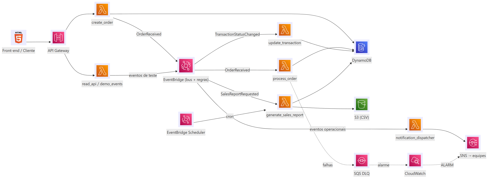
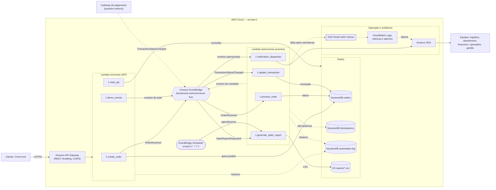

# Arquitetura geral — TechCommerce Serverless

Visão geral dos serviços AWS e de suas conexões. Os nomes de recursos seguem o template
`infrastructure/template.yaml` (prefixo `techcommerce-<ambiente>-`).

Versão com ícones oficiais da AWS (pacote `logos` do Iconify), usada no relatório:

## Diagrama geral (Mermaid)

## Responsabilidade de cada serviço

| Serviço | Papel na solução |
|---|---|
| Amazon API Gateway | Porta de entrada HTTPS; throttling; CORS; integração Lambda Proxy |
| AWS Lambda | 7 funções com responsabilidade única (receber, processar, atualizar transação, relatório, notificar, consultar, publicar eventos de demonstração) |
| Amazon EventBridge | Barramento customizado; regras por `source`/`detail-type`; arquivo para replay |
| EventBridge Scheduler | Agendamento do relatório (cron com fuso America/Sao_Paulo, retentativas e DLQ) |
| Amazon DynamoDB | Pedidos (status + histórico), chaves de idempotência e histórico de automações |
| Amazon S3 | Relatórios CSV criptografados, privados, com ciclo de vida |
| Amazon SNS | Notificações às equipes, com atributos para *filter policies* |
| Amazon SQS | Dead Letter Queue de eventos/invocações que falharam |
| Amazon CloudWatch | Logs JSON estruturados, métricas EMF e alarmes (DLQ, erros, 5XX) |
