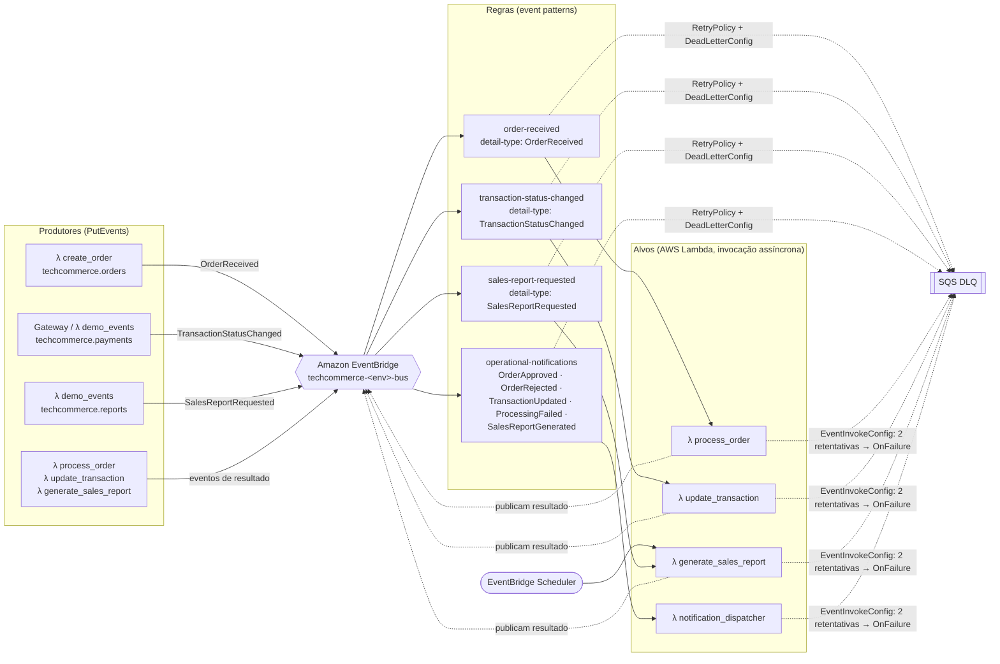
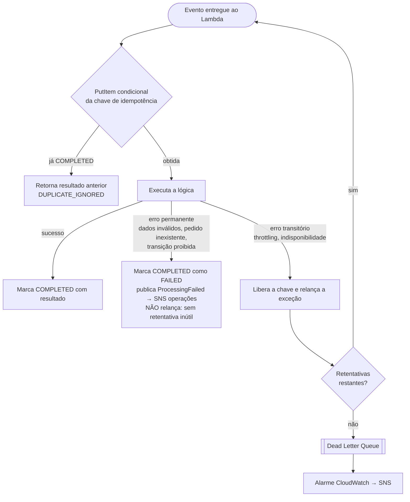

# Fluxo de eventos entre Amazon EventBridge e AWS Lambda

Cada evento possui `source`, `detail-type` e um envelope `detail = {metadata, data}`.
As regras abaixo estão declaradas no template e são aplicadas também pelo simulador local.



## Tratamento de falhas e idempotência



## Exemplo de evento

```json
{
  "source": "techcommerce.orders",
  "detail-type": "OrderReceived",
  "detail": {
    "metadata": {
      "eventId": "1b0d3c5e-…",
      "correlationId": "4f35da88-…",
      "occurredAt": "2026-11-21T00:51:44.315Z",
      "schemaVersion": "1.0",
      "producer": "create_order"
    },
    "data": { "orderId": "ORD-2C52633F0D45", "total": 4079.7, "paymentMethod": "PIX", "itemsCount": 3 }
  }
}
```
