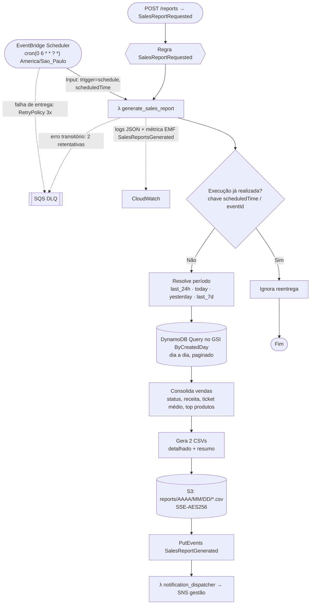
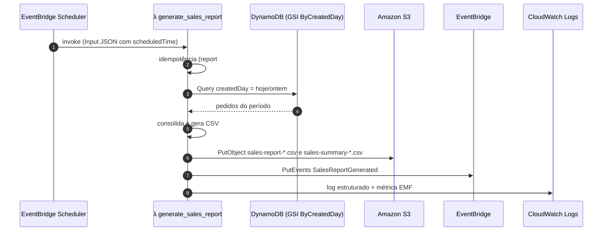

# Fluxo de geração automática de relatórios (Fluxo 3)

O agendamento é definido no parâmetro `ReportScheduleExpression` do template
(padrão `cron(0 6 * * ? *)`, fuso `America/Sao_Paulo`, ou seja, todos os dias às 06:00).
Também é possível solicitar o relatório sob demanda publicando `SalesReportRequested`.

